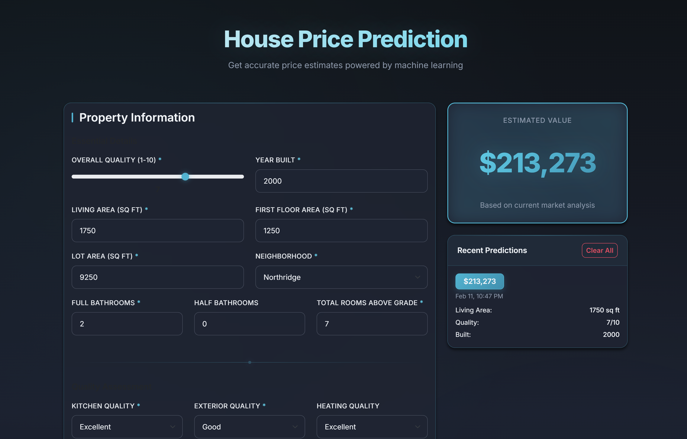
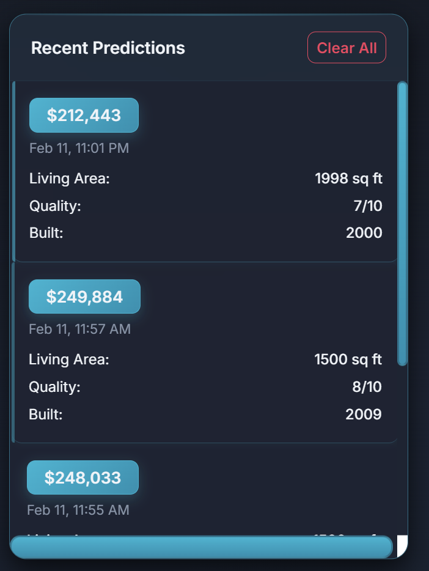
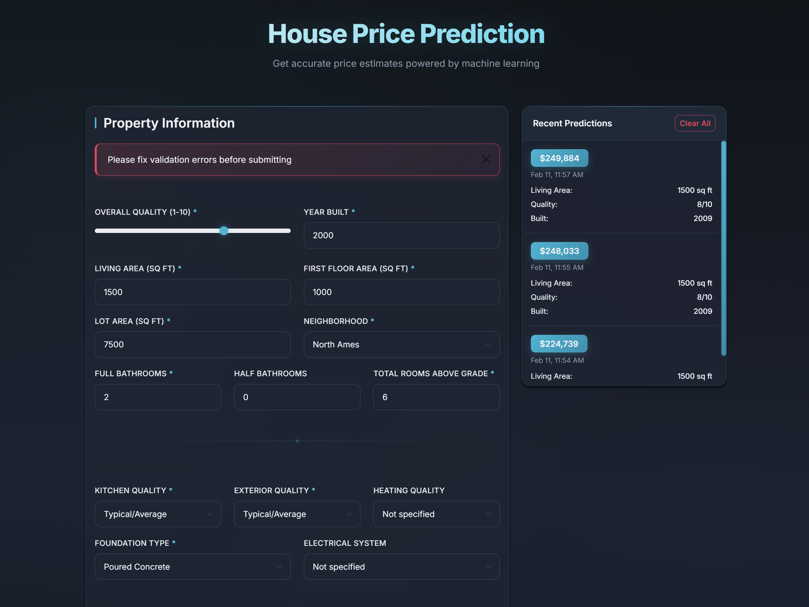
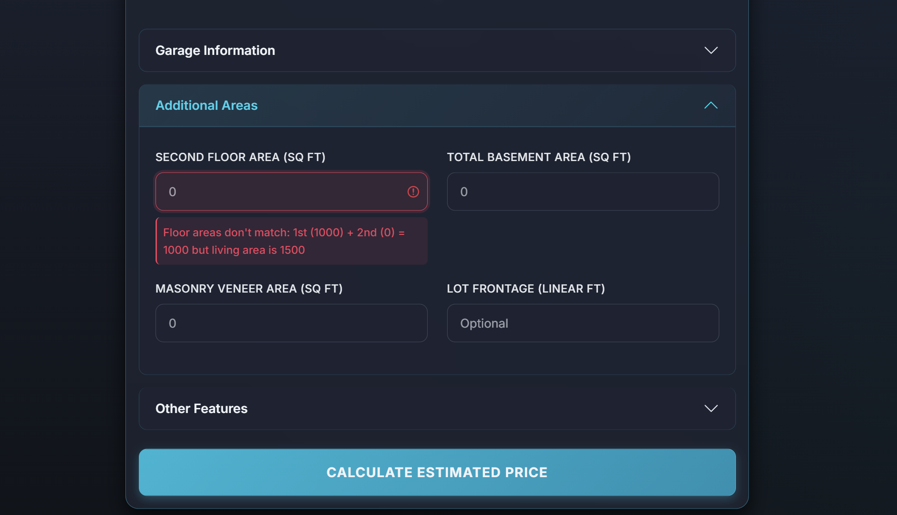
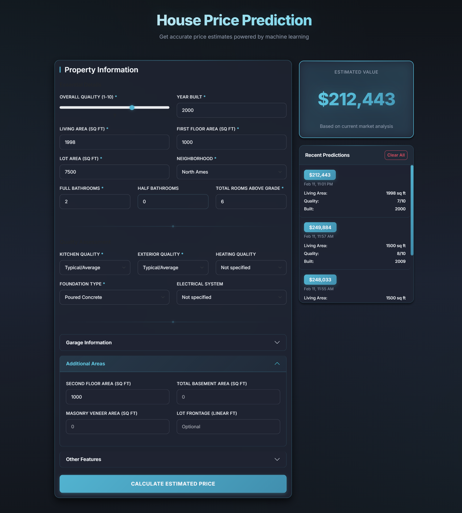

# House Price Prediction — Final Project

**Author:** Cornescu Darius  
**Internship Deliverable:** Full-stack ML application for house price estimation

---

## Overview

This is the **final project** of the internship: a full-stack web application that predicts house prices using a trained XGBoost model. Users input property details via a form, and the app returns an estimated price in USD.

---

## Screenshots

### App Homepage / Main Form


*The main form with essential property details, quality assessment, and optional sections (Garage, Additional Areas, Other Features).*

---

### Prediction History


*The Recent Predictions panel showing the last 10 predictions with timestamps and key property details.*

---

### Validation in Action





---

### Full App Layout


*Full app layout: form on the left, prediction result and history on the right.*

---

## Model Architecture

### Machine Learning Model

| Property | Value |
|----------|-------|
| **Algorithm** | XGBoost (XGBRegressor) |
| **Library** | scikit-learn compatible (`xgboost` package) |
| **File** | `ml_models/complete_pipeline.joblib` |

### Model Parameters

- **n_estimators:** 500
- **learning_rate:** 0.1
- **max_depth:** 5
- **random_state:** 42
- **objective:** reg:squarederror

### Pipeline

The pipeline is a single `joblib` object that includes:

1. **Preprocessing**
   - **Numerical:** KNNImputer (or SimpleImputer) for missing values
   - **Categorical:** OneHotEncoder for categorical features
   - **ColumnTransformer** to combine numerical and categorical branches

2. **Regressor**
   - XGBRegressor

### Features Used

| Category | Features |
|----------|----------|
| **Mandatory** | OverallQual, GrLivArea, 1stFlrSF, FullBath, TotRmsAbvGrd, YearBuilt, LotArea, KitchenQual, Foundation, ExterQual, Neighborhood |
| **Optional** | YearRemodAdd, GarageYrBlt, GarageCars, GarageArea, TotalBsmtSF, MasVnrArea, Fireplaces, LotFrontage, 2ndFlrSF, HalfBath, HeatingQC, Electrical |

---

## How It Works

### 1. User Input

The user fills the form with:

- **Essential details:** Overall quality (1–10), year built, living area, first floor area, lot area, neighborhood, bathrooms, total rooms
- **Quality:** Kitchen quality, exterior quality, foundation type, heating, electrical
- **Optional:** Garage, basement, second floor, remodeling year, fireplaces, etc.

### 2. Validation

- **Client-side:** React validators enforce ranges, required fields, and basic consistency
- **Server-side:** Pydantic models validate:
  - YearRemodAdd ≥ YearBuilt
  - GarageYrBlt ≥ YearBuilt − 1
  - Garage area vs cars consistency (100–500 sq ft per car)
  - Floor areas sum ≈ living area
  - Lot area > living area
  - Bathrooms vs rooms consistency
  - Quality consistency (Overall vs Kitchen/Exterior)
  - Recent construction (post-1990) → modern electrical system

### 3. Prediction

1. Frontend sends POST to `http://localhost:8000/predict`
2. Backend converts JSON to DataFrame
3. Pipeline (preprocessor + XGBRegressor) predicts
4. Response: `{ "predicted_price": 123456.78 }`

### 4. Display

- Predicted price is shown in USD
- Entry is saved to history (last 10, stored in localStorage)

---

## Architecture

```
final_project/
├── backend/           # FastAPI REST API
│   ├── main.py        # App entry, CORS, middleware
│   ├── models.py      # Pydantic models (HousePredictionInput, PredictionOutput)
│   ├── router.py      # /predict, /health endpoints
│   ├── services.py    # Prediction logic
│   └── storage.py     # Load/cache joblib pipeline
├── frontend/          # React + Vite
│   └── src/
│       ├── App.jsx
│       ├── components/   # Form, Result, History
│       ├── services/     # API client
│       └── utils/        # Validators
├── ml_models/
│   └── complete_pipeline.joblib
├── screenshots/       # Place your app screenshots here
└── README.md
```

---

## Tech Stack

| Layer | Technology |
|-------|------------|
| **Backend** | Python | FastAPI | uvicorn |
| **Frontend** | React | Vite | Bootstrap |
| **ML** | scikit-learn | XGBoost | joblib |
| **Data** | pandas | Pydantic |

---

## Getting Started

### Prerequisites

- Python 3.10+
- Node.js 18+

### Backend

```bash
# From project root (House-price-prediction)
pip install -r requirements.txt

# Run the API (from final_project folder)
cd final_project
uvicorn backend.main:app --reload --host 0.0.0.0 --port 8000
```

API runs at: **http://localhost:8000**

### Frontend

```bash
cd final_project/frontend
npm install
npm run dev
```

Frontend runs at: **http://localhost:5173**

### API Endpoints

| Method | Endpoint | Description |
|--------|----------|-------------|
| GET | `/api` | API info |
| GET | `/health` | Health check |
| POST | `/predict` | Predict house price |

---

*Final project by Cornescu Darius — House Price Prediction.*
